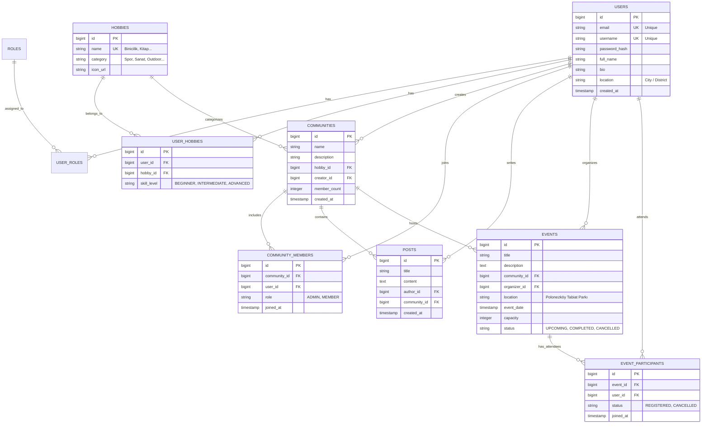

# HobbyPath — Veritabanı Mimarisi (Database Design) 🗄️

Bu doküman HobbyPath MVP sürümü için ilişkisel veri modelini, tablo detaylarını, veri tiplerini ve kısıtları (constraints) içerir.

---

## 1. Varlık İlişki Diyagramı (ER Diagram)

---

## 2. Tablo Tanımları ve Kısıtlar (Constraints)

### `users`
- `id`: BIGSERIAL / BIGINT PRIMARY KEY
- `email`: VARCHAR(255) NOT NULL UNIQUE
- `username`: VARCHAR(50) NOT NULL UNIQUE
- `password_hash`: VARCHAR(255) NOT NULL (BCrypt hash)
- `full_name`: VARCHAR(100) NOT NULL
- `bio`: TEXT NULL
- `location`: VARCHAR(100) NULL (Örn: "Kadıköy, İstanbul")
- `created_at`: TIMESTAMP WITH TIME ZONE DEFAULT CURRENT_TIMESTAMP

### `roles` & `user_roles`
- `roles`: `id`, `name` (ROLE_USER, ROLE_ADMIN)
- `user_roles`: `user_id`, `role_id` (Composite PK veya Surrogate PK + Unique Constraint)

### `hobbies`
- `id`: BIGSERIAL PRIMARY KEY
- `name`: VARCHAR(100) NOT NULL UNIQUE (Örn: "Horse Riding", "Reading", "Ceramics")
- `category`: VARCHAR(50) NOT NULL (Örn: "Sports", "Arts", "Literature")
- `icon_url`: VARCHAR(255) NULL

### `user_hobbies`
- `id`: BIGSERIAL PRIMARY KEY
- `user_id`: BIGINT REFERENCES users(id) ON DELETE CASCADE
- `hobby_id`: BIGINT REFERENCES hobbies(id) ON DELETE CASCADE
- `skill_level`: VARCHAR(20) NOT NULL (CHECK: 'BEGINNER', 'INTERMEDIATE', 'ADVANCED')
- **Constraint:** `UNIQUE(user_id, hobby_id)` -> Bir kullanıcı aynı hobiyi iki kez ekleyemez.

### `communities`
- `id`: BIGSERIAL PRIMARY KEY
- `name`: VARCHAR(150) NOT NULL
- `description`: TEXT NULL
- `hobby_id`: BIGINT REFERENCES hobbies(id) ON DELETE RESTRICT
- `creator_id`: BIGINT REFERENCES users(id) ON DELETE SET NULL
- `member_count`: INTEGER DEFAULT 1
- `created_at`: TIMESTAMP WITH TIME ZONE DEFAULT CURRENT_TIMESTAMP

### `community_members`
- `id`: BIGSERIAL PRIMARY KEY
- `community_id`: BIGINT REFERENCES communities(id) ON DELETE CASCADE
- `user_id`: BIGINT REFERENCES users(id) ON DELETE CASCADE
- `role`: VARCHAR(20) DEFAULT 'MEMBER' (CHECK: 'ADMIN', 'MODERATOR', 'MEMBER')
- `joined_at`: TIMESTAMP WITH TIME ZONE DEFAULT CURRENT_TIMESTAMP
- **Constraint:** `UNIQUE(community_id, user_id)`

### `posts`
- `id`: BIGSERIAL PRIMARY KEY
- `title`: VARCHAR(200) NOT NULL
- `content`: TEXT NOT NULL
- `author_id`: BIGINT REFERENCES users(id) ON DELETE CASCADE
- `community_id`: BIGINT REFERENCES communities(id) ON DELETE CASCADE
- `created_at`: TIMESTAMP WITH TIME ZONE DEFAULT CURRENT_TIMESTAMP

### `events`
- `id`: BIGSERIAL PRIMARY KEY
- `title`: VARCHAR(200) NOT NULL
- `description`: TEXT NULL
- `community_id`: BIGINT REFERENCES communities(id) ON DELETE CASCADE
- `organizer_id`: BIGINT REFERENCES users(id) ON DELETE SET NULL
- `location`: VARCHAR(255) NOT NULL
- `event_date`: TIMESTAMP WITH TIME ZONE NOT NULL
- `capacity`: INTEGER NOT NULL CHECK (capacity > 0)
- `status`: VARCHAR(20) DEFAULT 'UPCOMING' (CHECK: 'UPCOMING', 'COMPLETED', 'CANCELLED')
- `created_at`: TIMESTAMP WITH TIME ZONE DEFAULT CURRENT_TIMESTAMP

### `event_participants`
- `id`: BIGSERIAL PRIMARY KEY
- `event_id`: BIGINT REFERENCES events(id) ON DELETE CASCADE
- `user_id`: BIGINT REFERENCES users(id) ON DELETE CASCADE
- `status`: VARCHAR(20) DEFAULT 'REGISTERED' (CHECK: 'REGISTERED', 'CANCELLED', 'WAITLIST')
- `joined_at`: TIMESTAMP WITH TIME ZONE DEFAULT CURRENT_TIMESTAMP
- **Constraint:** `UNIQUE(event_id, user_id)`
